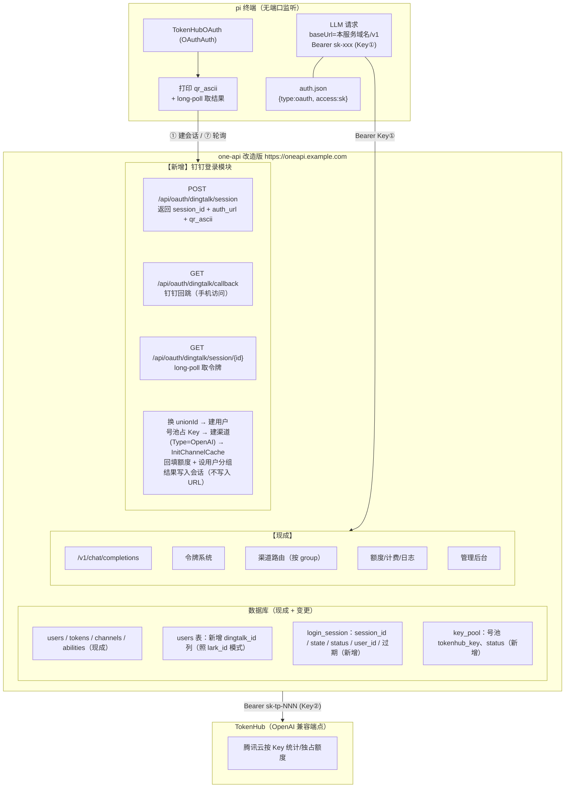
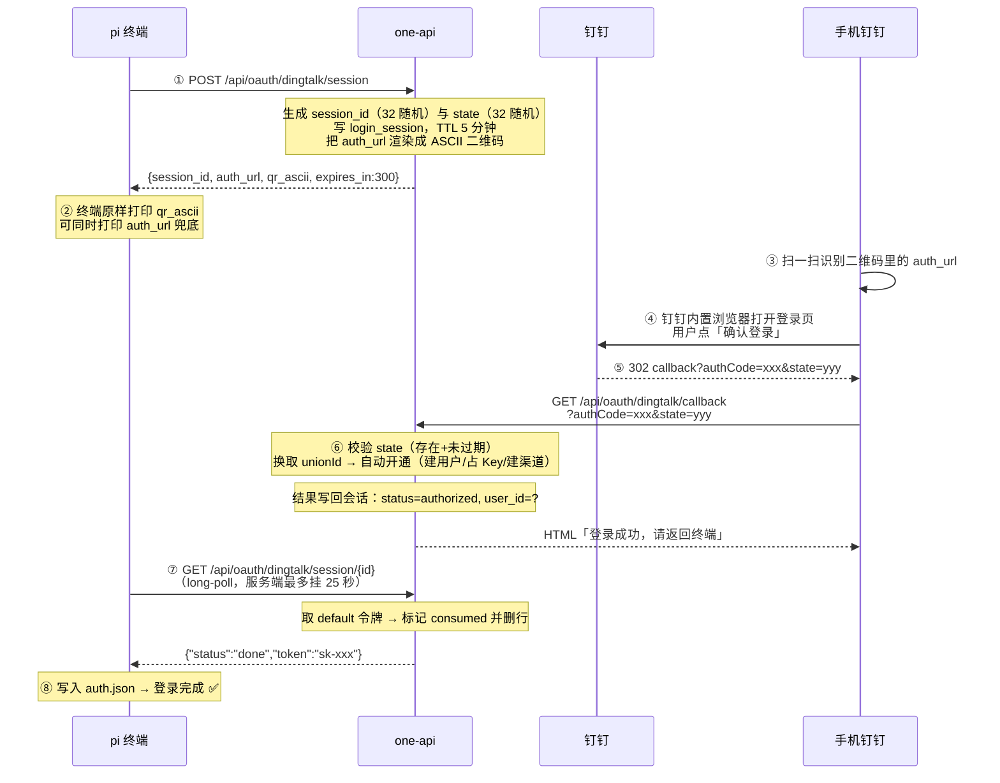
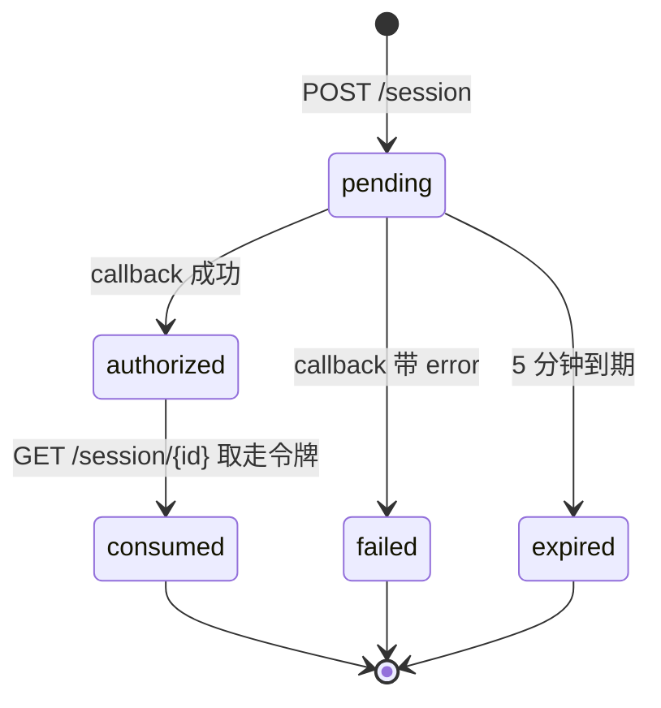

# tokenhub 方案 2：终端二维码 + 服务端轮询（无 loopback）

**一句话**：客户端不监听任何端口、不起临时 HTTP 服务器——向 one-api 要一个会话，把服务端渲染好的 ASCII 二维码打到终端，用户用手机钉钉扫码授权，客户端 long-poll 取回令牌。

**与方案 1（`auth_api.md`）的关系**：业务逻辑（建用户、占号池、建渠道、发令牌、一次性凭证、限流）完全一致，只替换「结果如何回到客户端」这一段——方案 1 靠 `302 → 127.0.0.1:53721` 的 loopback 回调，方案 2 靠会话 + 轮询。本文只写差异部分与完整流程，未提及处与方案 1 相同。

---

## 0. 两方案对比速览

| 维度 | 方案 1：loopback 回调 | 方案 2：终端二维码 + 轮询 |
|---|---|---|
| 需要电脑上有浏览器 | **需要** | 不需要 |
| 授权动作发生在 | 电脑浏览器 | 手机钉钉 |
| 客户端监听端口 | 有（`127.0.0.1:53721`，随机端口） | **无** |
| 客户端代码量 | 临时 HTTP server + state 校验 + 兑换 | 发一次请求、打印字符串、轮询 |
| 客户端依赖 | 无（但要处理端口占用/防火墙弹窗） | 无（二维码由服务端渲染） |
| 客户端是否传入 `redirect_uri` | 是（需校验必须是 `127.0.0.1`） | **否**（服务端写死） |
| 令牌回到客户端的方式 | 302 带一次性短码 → POST 兑换 | long-poll 直接返回 JSON |
| 接口数 | 3（login / callback / exchange） | 3（session / callback / session 查询） |
| 新增攻击面 | `redirect_uri` 伪造（`@evil.com` 绕过） | 二维码被旁人扫走导致「串号」 |
| 网络要求 | 电脑浏览器能访问 one-api | **手机**能访问 one-api 公网域名 |
| 适合场景 | 桌面为主、内网部署 | CLI/TUI 为主、无桌面环境、SSH 远程 |

**结论**：方案 2 的客户端更干净（无端口、无本地回调、无 `redirect_uri` 入参），代价是手机必须能访问 one-api 的公网域名，以及多一个「扫码串号」风险点（可缓解，见第 8 节）。

---

## 1. 角色与凭据

沿用方案 1：4 个参与方（pi 终端 / one-api / TokenHub / 钉钉），3 种 Key（① one-api 令牌 `sk-xxx` 存 `auth.json`；② TokenHub 真 Key 存渠道配置；③ 钉钉 AppSecret 存环境变量）。用户只见 Key①，Key②③ 永不出服务器。

映射仍用 one-api 分组机制，不建映射表：`users.group = user-{id}` ↔ 渠道 `group = user-{id}`。

---

## 2. 总体架构



与方案 1 的区别：客户端 subgraph 里 **`loopback 回调` 节点被删掉**；新增 `login_session` 表；三个端点是 `session 创建 / callback / session 查询`。

隐藏依赖不变：路由数据源是 `abilities` 表 + 进程内 `group2model2channels` 缓存，所以建渠道必须走 `Channel.Insert()` 并 `InitChannelCache()`。

---

## 3. 登录流程



关键差异：**二维码里放的是钉钉授权 URL，不是自定义协议**。所以不需要钉钉的「内嵌二维码 JS SDK」，也不需要客户端有 H5 环境；终端只是把一段 URL 编码成二维码。

---

## 4. 接口契约

### 4.1 `POST /api/oauth/dingtalk/session`

创建登录会话。挂 `middleware.CriticalRateLimit()`。

请求体为空（也可带 `client:"pi"` 用于埋点）。

响应：

```json
{
  "session_id": "8f3a...（32 字符，仅此一次返回）",
  "auth_url": "https://login.dingtalk.com/oauth2/auth?client_id=AppKey&response_type=code&scope=openid&prompt=consent&redirect_uri=https%3A%2F%2Foneapi.example.com%2Fapi%2Foauth%2Fdingtalk%2Fcallback&state=yyy",
  "qr_ascii": "████████████████...",
  "expires_in": 300
}
```

- `auth_url` 里的 `redirect_uri` **由服务端拼接**，不接受客户端传入——方案 1 的 `redirect_uri` 校验逻辑整段删除。
- `qr_ascii` 用 `skip2/go-qrcode` 的 `ToSmallString()`（半高块字符），直接可打印；不用客户端装库。
- 同一次会话只生成一个 `state`，与 `session_id` 分离（`state` 会出现在二维码和 URL 里，`session_id` 不出现在任何扫码可得的介质中）。

### 4.2 `GET /api/oauth/dingtalk/callback?authCode=xxx&state=yyy`

与方案 1 的 callback 前半段完全一致：

1. 校验 `state`（存在、未过期、`status=pending`）
2. `POST https://api.dingtalk.com/v1.0/oauth2/userAccessToken`（clientId/clientSecret/code/grantType）
3. `GET https://api.dingtalk.com/v1.0/contact/users/me`（`x-acs-dingtalk-access-token`）→ unionId、nick
4. 自动开通（见第 5 节）
5. 结果写回会话：`status='authorized', user_id=?`，过期时间改为 `now+60s`（只留够客户端取走）
6. 响应 **HTML 页面**（不是 302）：「登录成功，请返回终端」。手机端 302 到 `127.0.0.1` 是无效的，这是方案 2 必须改的地方
7. 失败分支：`?error=yyy&state=yyy` → `status='failed'`，HTML 显示错误原因；`state` 无效则直接 400

### 4.3 `GET /api/oauth/dingtalk/session/{session_id}`

取令牌，long-poll。挂 `CriticalRateLimit()`（按 IP 而非按会话，避免一个会话刷爆连接）。

- `status=pending`：服务端每 1 秒查一次库，最多挂 25 秒；超时返回 `204 No Content`，客户端重新请求
- `status=authorized`：读出 `user_id` → 查 `user_id=? AND name='default'` 的令牌 → 返回 `{"status":"done","token":"sk-xxx"}` → 删除会话行（一次性）
- `status=failed`：返回 `{"status":"failed","reason":"..."}` 并删除会话行
- 会话不存在或已过期：`404` / `410`
- default 令牌被用户删过：按方案 1 的兜底新建 `Token{ExpiredTime:-1, RemainQuota:-1, UnlimitedQuota:true, Key: random.GenerateKey()}`

> 单实例部署用「1 秒 ticker + 查库」即可；多实例要跨进程唤醒，把会话状态放 Redis 并加 pub/sub（本期不做）。

---

## 5. 自动开通（与方案 1 相同）

`FillUserByDingtalkId(unionId)` 命中则跳过建用户，直接做「取 default 令牌」。

1. 建用户：`Username = "dt_" + random.GetRandomString(8)`（11 位 ≤ `validate:"max=12"`）、`DisplayName = nick`、`DingtalkId = unionId`、`Role = RoleCommonUser`、`Status = UserStatusEnabled`，然后 `user.Insert(ctx, 0)`（内部已生成 AccessToken/AffCode 并建 default 令牌）
2. 回填：`user.Quota = TOKENHUB_USER_QUOTA`（默认 100000000 ≈ $200，`QuotaPerUnit=500000`）、`user.Group = fmt.Sprintf("user-%d", user.Id)`、`user.Update(false)`；Redis 开启时 `DEL user_group:{id}`
3. 号池原子占 Key：单条 `UPDATE ... WHERE id=(SELECT ... WHERE status='未分配' ORDER BY id LIMIT 1) AND status='未分配'`；影响 0 行先重试一次，仍为 0 才算号池空（返回明确错误 + 告警）
4. 建渠道：`Type=channeltype.OpenAI`、`Status=ChannelStatusEnabled`、`BaseURL=&upstreamURL`（主机根地址，不带 `/v1`）、`Key=poolKey`、`Models=TOKENHUB_MODELS`、`Group=user.Group`，调用 `channel.Insert()`（内部 `DB.Create` + `AddAbilities()`）；失败则把号池行改回未分配并清 `union_id`
5. `model.InitChannelCache()`
6. 不要用 `DB.Transaction` 包第 3~4 步（`AddAbilities` 走全局 DB，事务不回滚 Ability）

---

## 6. 会话表与状态机

```sql
CREATE TABLE login_session (
  session_id CHAR(32) PRIMARY KEY,   -- 只返回给创建者，扫码介质中不出现
  state      CHAR(32) NOT NULL UNIQUE,
  status     VARCHAR(16) NOT NULL,   -- pending / authorized / failed
  user_id    BIGINT DEFAULT 0,
  reason     VARCHAR(255) DEFAULT '',
  expire_at  DATETIME NOT NULL,
  created_at DATETIME NOT NULL
);
```



清理：定时任务删 `expire_at < now()` 的行（或取令牌时惰性删除）。

---

## 7. 客户端改造（TypeScript）

`packages/ai/src/auth/oauth/tokenhub.ts`，比方案 1 明显短：

```ts
async login() {
  const r = await fetch(`${TOKENHUB}/api/oauth/dingtalk/session`, { method: "POST" });
  const { session_id, auth_url, qr_ascii } = await r.json();

  console.log(qr_ascii);                  // 终端直接打印
  console.log("或用手机钉钉打开：", auth_url);

  for (;;) {                              // long-poll
    const res = await fetch(`${TOKENHUB}/api/oauth/dingtalk/session/${session_id}`, { method: "GET" });
    if (res.status === 204) continue;     // 25 秒内未授权，继续等
    const body = await res.json();
    if (body.status === "done") {
      return { type: "oauth", access: body.token, refresh: "", expires: Number.MAX_SAFE_INTEGER };
    }
    throw new Error(body.reason ?? "登录失败");
  }
}
```

- 不再需要 `startOAuthCallbackServer`
- 不再需要本地端口、state 校验、短码兑换
- 不再需要 `interaction.notify({type:"auth_url"})`（如果 pi 的 notify 只用于展示，可省略；若要复用 UI，可把 `auth_url` 传进去，用户点开就是普通浏览器流程）

---

## 8. 安全设计

| 风险 | 防护 | 位置 |
|---|---|---|
| session_id 被猜 | 32 字符随机、5 分钟 TTL、仅创建时返回一次、取走即删 | login_session |
| 会话被轮询刷爆 | 查询接口 `CriticalRateLimit()`（按 IP）+ long-poll 25 秒挂起 | router + handler |
| **扫码串号**（旁人扫走你的二维码，用自己的钉钉授权，你的终端拿到**对方**的令牌） | TTL 5 分钟 + 一次性；客户端拿到令牌后打印「登录为 {nick}」供用户核对；高安全场景可加「终端显示 6 位确认码，callback 后要求手机端输入」 | 客户端 / callback |
| state 伪造 / 重放 | 随机 32 字符、5 分钟、用后即删（`status=pending` 才接受） | login_session |
| authCode 重放 | 钉钉原生一次性 + 5 分钟 | 钉钉侧 |
| 真令牌出现在 URL / 二维码 | 已消除：二维码里只有 `auth_url`，令牌只经 long-poll 的 JSON 返回 | 全链路 |
| 令牌含 `-` 被截断 | `Token.Key` 用 `random.GenerateKey()`（纯字母数字） | 建令牌时 |
| callback 被刷（放大打钉钉 API） | `/callback` 挂 `CriticalRateLimit()` | router |
| Key② 泄露 | 只存服务端 DB；控制台重置后同步 key_pool | 运维流程 |
| AppSecret 泄露 | 仅环境变量，不进代码/git | 部署规范 |
| 号池被刷空 | 新用户额度封顶 + 号池余量告警 | key_pool + 监控 |
| 渠道残留导致脏路由 | 回收必须走 `channel.Delete()`（会删 Ability）+ `InitChannelCache()` | 运维流程 |

相比方案 1：**删掉**「伪造 redirect_uri 窃取令牌」整行（客户端不再传 `redirect_uri`），**新增**「扫码串号」行。

> 串号风险的实际影响面：攻击者需要「看到你的二维码 + 在你 5 分钟窗口内抢先扫码 + 用自己的钉钉确认」，结果是你的终端被登录成**攻击者的账号**（你消耗的是攻击者的额度，攻击者拿到的是你后续对话的上游退出通道）。不会泄露你的身份，但会导致日志串位。可接受则不加确认码；不可接受就加「6 位确认码」增强。

---

## 9. 开发清单

### 9.1 one-api 侧（Go）

| 文件 | 内容 | 规模 |
|---|---|---|
| `model/user.go`（改） | `DingtalkId` 列（照 `LarkId`）+ `FillUserByDingtalkId()` + `IsDingtalkIdAlreadyTaken()` | ~30 行 |
| `model/key_pool.go`（新） | 号池表 + 原子占用/归还/补货 | ~60 行 |
| `model/login_session.go`（新） | 会话表 + 创建/查询/置为已授权/消费删除 | ~70 行 |
| `controller/auth/dingtalk.go`（新） | 建会话（含二维码渲染）+ 回调 + 自动开通 + long-poll 查询 | ~300 行 |
| `router/api.go`（改） | 3 条路由，均挂 `CriticalRateLimit()` | 3 行 |
| `main.go`（改） | 读钉钉 / TokenHub 环境变量 | ~5 行 |

路由（`apiRouter` 下）：

```
POST /api/oauth/dingtalk/session        建会话（返回 qr_ascii）
GET  /api/oauth/dingtalk/callback       钉钉回跳（手机访问）
GET  /api/oauth/dingtalk/session/:id    取令牌（long-poll）
```

新增 Go 依赖：`github.com/skip2/go-qrcode`（纯 Go，无 CGO）。

### 9.2 客户端侧（TypeScript）

| 文件 | 内容 |
|---|---|
| `packages/ai/src/auth/oauth/tokenhub.ts`（新） | 见第 7 节，约 25 行 |
| 注册 provider（改） | 把 `tokenhub` 加进 OAuth provider 列表 |

### 9.3 明确不用写

OpenAI 兼容网关、渠道路由、额度计费、管理后台、对话流式、建令牌（`user.Insert` 已建 default）、TokenHub 侧零开发、**客户端临时 HTTP 服务器**。

---

## 10. 配置清单

### 10.1 钉钉开放平台

```
① open-dev.dingtalk.com 登录（企业管理员/子管理员）
② 应用开发 → 企业内部应用 → 创建应用
③ 凭证：拿 Client ID(AppKey) / Client Secret
④ 权限管理：申请 Contact.User.Read
⑤ 安全设置 → 重定向 URL：
     https://oneapi.example.com/api/oauth/dingtalk/callback
   （方案 2 不再需要 http://127.0.0.1 白名单）
⑥ 版本管理与发布 → 发布（未发布扫码不生效）
```

### 10.2 环境变量

```
DINGTALK_CLIENT_ID / DINGTALK_CLIENT_SECRET
TOKENHUB_PUBLIC_URL=https://oneapi.example.com      // 对外域名，用于拼 callback 与客户端 baseUrl
TOKENHUB_UPSTREAM_URL=https://tokenhub.tencent.example  // 渠道 BaseURL：根地址，不带 /v1，末尾不带 /
TOKENHUB_MODELS=deepseek-v3,kimi-k2,...
TOKENHUB_USER_QUOTA=100000000
LOGIN_SESSION_TTL=300                                // 秒
LOGIN_SESSION_POLL_HOLD=25                           // long-poll 挂起秒数
```

`TOKENHUB_UPSTREAM_URL` 与客户端 `baseUrl` 仍是两个值：渠道填根地址（one-api 自己拼 `/v1/chat/completions`），客户端用 `${TOKENHUB_PUBLIC_URL}/v1`。

### 10.3 腾讯 TokenHub

控制台开通 → 记录 OpenAI 兼容端点 → 批量创建 Key（每次 1~10 个）导入 `key_pool`（`status='未分配'`）→ 按需开通 Token Plan → 余量低于阈值重复补货。

---

## 11. 验收标准

| # | 场景 | 期望 |
|---|---|---|
| 1 | 终端执行登录 | 终端出现可扫的二维码，`auth_url` 同时打印 |
| 2 | 手机钉钉扫码并确认 | 手机上显示「登录成功，请返回终端」；终端 1 秒内返回令牌 |
| 3 | 手机不扫码，等 25 秒 | 客户端收到 204 后自动再次轮询，不报错 |
| 4 | 会话超过 5 分钟 | 轮询返回 410，终端提示重新登录 |
| 5 | 同一会话取两次令牌 | 第二次 404（已消费删除） |
| 6 | 扫码后拒绝授权 | callback 走 `error` 分支，会话 `failed`，终端提示原因 |
| 7 | 并发两终端同时登录 | 两个会话、两个不同 Key、两条渠道，互不影响 |
| 8 | 登录后立刻对话 | 通（依赖 `InitChannelCache`，无需等 `SYNC_FREQUENCY`） |
| 9 | 号池为空 | 明确提示「额度号池耗尽，请联系管理员」+ 告警 |
| 10 | 停用用户 | `channel.Delete()` + `InitChannelCache()`，该 group 路由立即失效 |

---

## 12. 从方案 1 迁移要删掉的东西

- 客户端：`startOAuthCallbackServer`、随机端口、`state` 本地校验、`POST /exchange` 调用
- 服务端：`redirect_uri` 入参校验（含 `url.Parse` 取 Host 的那段）、一次性短码 `type='short_code'`、`POST /exchange`
- 文档：方案 1 §8 的「伪造 redirect_uri」风险行

保留不动：`users.dingtalk_id`、`key_pool`、渠道创建五步（`channel.Insert()` + `InitChannelCache()`）、`TOKENHUB_*` 环境变量、钉钉侧两项配置。

---

## 13. 结论

- 只想让 **pi 客户端更干净**（无端口、无本地服务器、无 redirect_uri 入参）→ 选方案 2，代价是手机要能访问 one-api 公网域名，并接受 5 分钟窗口内的「扫码串号」残余风险（可加确认码消除）。
- 部署在**纯内网**、手机无法访问 one-api、且电脑一定有浏览器 → 方案 1 更稳。
- 两者可以共存：`session` 响应里的 `auth_url` 本来就能直接点开走浏览器流程，即方案 2 天然包含方案 1 的降级路径；反向不成立。
