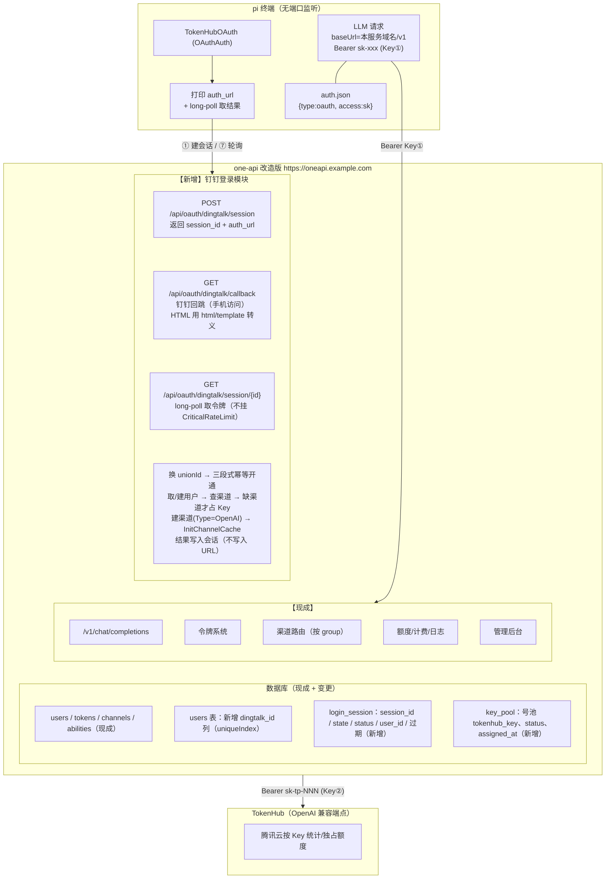
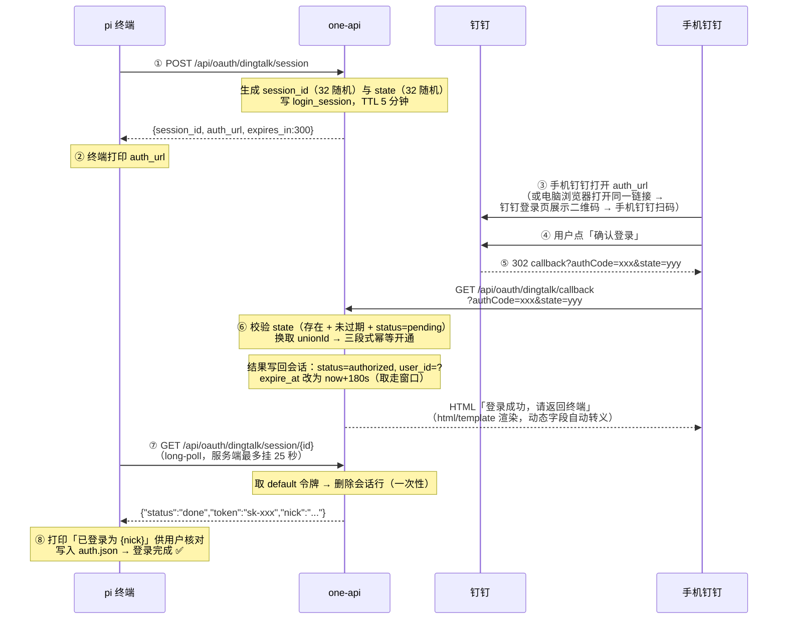
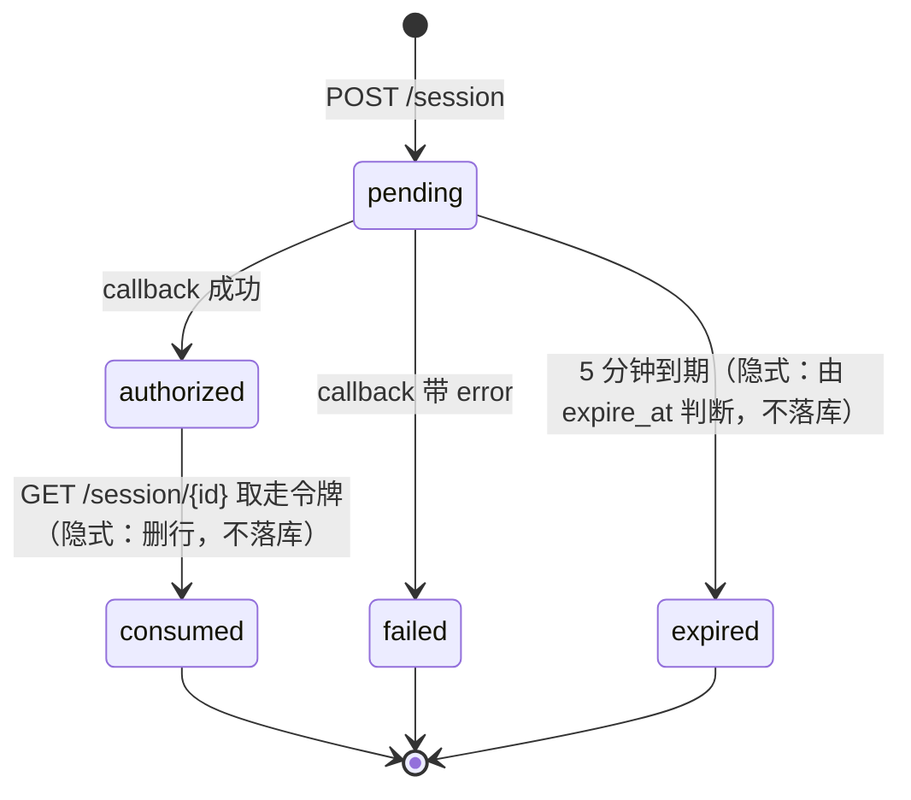

# tokenhub 方案 2：终端授权链接 + 服务端 long-poll（无 loopback）

**一句话**：客户端不监听任何端口、不起临时 HTTP 服务器——向 one-api 要一个会话，把授权链接打印到终端，用户用手机钉钉打开（或在任意设备浏览器打开，钉钉登录页自带二维码供手机扫），客户端 long-poll 取回令牌。

**与方案 1（`auth_api.md`）的关系**：业务逻辑（建用户、占号池、建渠道、发令牌、一次性凭证、限流）完全一致，只替换「结果如何回到客户端」这一段——方案 1 靠 `302 → 127.0.0.1:53721` 的 loopback 回调，方案 2 靠会话 + 轮询。本文只写差异部分与完整流程，未提及处与方案 1 相同。

> **v2 修订记录**（按 one-api / pi 源码审查结论修订）：
> 1. **移除 `qr_ascii` 与 `skip2/go-qrcode` 依赖**。钉钉登录页自带二维码，终端只需打印 `auth_url`；pi 的 `AuthEvent` 只有 `info / auth_url / device_code / progress` 四种类型、没有 `qr` 类型，渲染二维码需要新增协议并改 4 个前端（且 p2 TUI 有宽度截断），收益为零。
> 2. **`GET /session/{id}` 不再挂 `CriticalRateLimit()`**。该限流是 20 次 / 20 分钟 / IP，且 `mark="CT"` 与 `login`、`register`、`reset_password` 等共享同一个桶；long-poll 每 25 秒一次，一次完整登录就要 12 次配额，同 IP 登录两次即 429，NAT 后全体用户互相挤爆。改由 `/api` 组已有的 `GlobalAPIRateLimit()`（480 次 / 3 分钟 / IP）兜底。
> 3. **号池占用改为两步 CAS**。MySQL 不允许 `UPDATE` 的子查询引用同一张目标表（ERROR 1093），原写法在 MySQL 上直接报错；同时给 `key_pool` 增加 `assigned_at`，用于崩溃后的惰性回收，防止 Key 永久泄漏。
> 4. **自动开通改为三段式幂等**：取/建用户 → 检查渠道是否已存在 → 缺渠道才占 Key。修复「首次登录在建渠道前失败 → 用户已存在但无渠道 → 之后每次登录都跳过建渠道、永远无法对话」的死状态。
> 5. **`users.dingtalk_id` 用 `uniqueIndex`**（不照抄 `LarkId` 的普通 `index`），防并发首登建出两个用户。
> 6. **补 `model/main.go` 的 `AutoMigrate(&KeyPool{}, &LoginSession{})`**，否则两张新表不会被创建。
> 7. **callback HTML 用 `html/template` 渲染**，`reason` 等外部输入自动转义，消除公网无鉴权接口上的反射型 XSS。
> 8. `expire_at` / `created_at` 改 **`BIGINT`（int64 秒）**，对齐全库时间字段风格（`helper.GetTimestamp()`）。
> 9. 客户端轮询加最小间隔与网络错误重试（防服务端异常快速返回时空转、防反代断连直接抛出）；`done` 响应带 `nick` 供终端核对身份。
> 10. 修正多处表述：§0 网络要求对比（两方案都需公网域名）、§4.3 多实例说明（long-poll 查库天然多实例可用，无需 Redis pub/sub）、§6 状态机（`expired`/`consumed` 为隐式状态）、§11 验收 #7；新增 §10.4 反代超时与 access log 脱敏配置。

---

## 0. 两方案对比速览

| 维度 | 方案 1：loopback 回调 | 方案 2：终端授权链接 + 轮询 |
|---|---|---|
| 需要电脑上有浏览器 | **需要** | 不需要（手机钉钉直接打开链接） |
| 授权动作发生在 | 电脑浏览器 | 手机钉钉（或任意设备浏览器 → 钉钉登录页扫码） |
| 客户端监听端口 | 有（`127.0.0.1:53721`，随机端口） | **无** |
| 客户端代码量 | 临时 HTTP server + state 校验 + 兑换 | 发一次请求、打印链接、轮询 |
| 客户端依赖 | 无（但要处理端口占用/防火墙弹窗） | 无（无需二维码库，复用现有 `auth_url` 事件） |
| 客户端是否传入 `redirect_uri` | 是（需校验必须是 `127.0.0.1`） | **否**（服务端写死） |
| 令牌回到客户端的方式 | 302 带一次性短码 → POST 兑换 | long-poll 直接返回 JSON |
| 接口数 | 3（login / callback / exchange） | 3（session / callback / session 查询） |
| 新增攻击面 | `redirect_uri` 伪造（`@evil.com` 绕过） | 授权链接被旁人打开导致「串号」 |
| 网络要求 | one-api 需公网 HTTPS 域名（钉钉 `redirect_uri` 必须公网），且**电脑浏览器**能访问它 | one-api 同样需公网 HTTPS 域名，且**手机**能访问它 |
| 适合场景 | 桌面为主、电脑一定有浏览器 | CLI/TUI 为主、无桌面环境、SSH 远程 |

**结论**：方案 2 的客户端更干净（无端口、无本地回调、无 `redirect_uri` 入参）。注意**两个方案都要求 one-api 有公网 HTTPS 域名**（钉钉回调地址必须公网可达），差别只在「谁要访问这个域名」——方案 1 是电脑浏览器，方案 2 是手机。方案 2 额外多一个「串号」风险点（可缓解，见第 8 节）。

---

## 1. 角色与凭据

沿用方案 1：4 个参与方（pi 终端 / one-api / TokenHub / 钉钉），3 种 Key（① one-api 令牌 `sk-xxx` 存 `auth.json`；② TokenHub 真 Key 存渠道配置；③ 钉钉 AppSecret 存环境变量）。用户只见 Key①，Key②③ 永不出服务器。

映射仍用 one-api 分组机制，不建映射表：`users.group = user-{id}` ↔ 渠道 `group = user-{id}`。

---

## 2. 总体架构



与方案 1 的区别：客户端 subgraph 里 **`loopback 回调` 节点被删掉**；新增 `login_session` 表；三个端点是 `session 创建 / callback / session 查询`。

隐藏依赖不变：路由数据源是 `abilities` 表 + 进程内 `group2model2channels` 缓存，所以建渠道必须走 `Channel.Insert()` 并 `InitChannelCache()`。

---

## 3. 登录流程



**为什么不需要自己渲染二维码**：`auth_url` 本身就是钉钉官方登录页地址，该页面在桌面浏览器打开时会自动展示钉钉的扫码二维码，手机钉钉内打开则直接走确认流程。终端自己把 URL 编码成二维码只是「省一次打开浏览器」，代价却是新增 `qr` 协议事件 + 改 4 个前端 + 新增 Go 依赖 + p2 TUI 宽度截断风险，不划算。

---

## 4. 接口契约

### 4.1 `POST /api/oauth/dingtalk/session`

创建登录会话。挂 `middleware.CriticalRateLimit()`（这是防滥用的写入口，限流合理）。

请求体为空（也可带 `client:"pi"` 用于埋点）。

响应：

```json
{
  "session_id": "8f3a...（32 字符，仅此一次返回）",
  "auth_url": "https://login.dingtalk.com/oauth2/auth?client_id=AppKey&response_type=code&scope=openid&prompt=consent&redirect_uri=https%3A%2F%2Foneapi.example.com%2Fapi%2Foauth%2Fdingtalk%2Fcallback&state=yyy",
  "expires_in": 300
}
```

- `auth_url` 里的 `redirect_uri` **由服务端拼接**，不接受客户端传入——方案 1 的 `redirect_uri` 校验逻辑整段删除。
- 同一次会话只生成一个 `state`，与 `session_id` 分离（`state` 会出现在授权链接里，`session_id` 不出现在任何用户可转发的介质中）。

### 4.2 `GET /api/oauth/dingtalk/callback?authCode=xxx&state=yyy`

挂 `CriticalRateLimit()`（防刷，避免被当成打钉钉 API 的放大器）。与方案 1 的 callback 前半段一致：

1. 校验 `state`（存在、未过期、`status=pending`）
2. `POST https://api.dingtalk.com/v1.0/oauth2/userAccessToken`（clientId/clientSecret/code/grantType）
3. `GET https://api.dingtalk.com/v1.0/contact/users/me`（`x-acs-dingtalk-access-token`）→ unionId、nick
4. 三段式幂等自动开通（见第 5 节）
5. 结果写回会话：`status='authorized', user_id=?`，过期时间改为 `now+180s`（取走窗口；网络抖动或用户重开终端时留有重试余地，过期后重新登录可自愈）
6. 响应 **HTML 页面**（不是 302）：「登录成功，请返回终端」。手机端 302 到 `127.0.0.1` 是无效的，这是方案 2 必须改的地方
7. 失败分支：`?error=yyy&state=yyy` → `status='failed'`，HTML 显示错误原因；`state` 无效则直接 400

> **HTML 必须转义**：`error` / `reason` / `nick` 都是外部可控输入，而该接口公网可达、无鉴权，直接拼字符串就是主域上的反射型 XSS（可读同域控制台 Cookie）。统一用 `html/template` 渲染（自动上下文转义），并加响应头 `Content-Type: text/html; charset=utf-8`、`X-Frame-Options: DENY`。

### 4.3 `GET /api/oauth/dingtalk/session/{session_id}`

取令牌，long-poll。**不挂 `CriticalRateLimit()`**，由 `/api` 组已有的 `GlobalAPIRateLimit()` 兜底。

> **为什么不挂 `CriticalRateLimit()`**：它是 20 次 / 20 分钟 / IP（`common/config/config.go:141-142`），且 `mark="CT"` 与 `login`、`register`、`reset_password`、`verification` 及其余 OAuth 入口共享同一个桶。long-poll 每 25 秒一次请求，一次完整登录（TTL 300s）消耗 12 次配额；同一 IP 20 分钟内登录两次就会 429，公司 NAT 后所有用户共用一个桶会更早耗尽。而 `/api` 组自带的 `GlobalAPIRateLimit()` 是 480 次 / 3 分钟 / IP，足以挡住刷量；`/v1` 中继路由不挂该限流，所以轮询也不会挤占用户的 LLM 请求配额。真正需要 `CriticalRateLimit()` 的是 4.1（写入口）和 4.2（放大出口）。

- `status=pending`：服务端每 1 秒查一次库，最多挂 25 秒；超时返回 `204 No Content`，客户端重新请求
- `status=authorized`：读出 `user_id` → 查 `user_id=? AND name='default'` 的令牌 → 返回 `{"status":"done","token":"sk-xxx","nick":"..."}` → 删除会话行（一次性）
- `status=failed`：返回 `{"status":"failed","reason":"..."}` 并删除会话行
- 会话不存在或已过期：`404` / `410`
- default 令牌被用户删过：按方案 1 的兜底新建 `Token{ExpiredTime:-1, RemainQuota:-1, UnlimitedQuota:true, Key: random.GenerateKey()}`

> **多实例**：long-poll 是「每 1 秒查一次库」，数据库本身就是多实例共享的，**天然支持多实例部署**（代价仅是每实例每秒一次 DB 查询），不需要 Redis pub/sub。需要跨进程推送的是 SSE 方案，不是本方案。

> **日志脱敏**：`session_id` 出现在 URL path 里，谁拿到它谁就能取走令牌，等价于临时凭据。反代 / 网关的 access log 必须对该路径脱敏（见 §10.4）。

---

## 5. 自动开通（三段式幂等）

**核心原则：任何一步失败后，重新登录都能收敛到「用户 + 渠道 + 令牌」齐备的终态，绝不重复建用户、重复占 Key。**

```
① 取/建用户（幂等）
   user.FillUserByDingtalkId(unionId)
   命中   → 使用该用户，继续往下走（不要跳过后续步骤！）
   未命中 → 构造 User{
              Username:    "dt_" + random.GetRandomString(8),   // 11 位 ≤ validate:max=12
              DisplayName: nick,
              DingtalkId:  unionId,
              Role:        RoleCommonUser,
              Status:      UserStatusEnabled,
            }
            user.Insert(ctx, 0)   // 内部已生成 AccessToken/AffCode 并建 default 令牌
            若返回 dingtalk_id 唯一键冲突（并发首登）→ 重新 FillUserByDingtalkId 取已建用户
   ★ 无论哪条路径，最后都必须 session.user_id = user.Id
     （否则「老用户重登」时会话里没有 user_id，取令牌环节查不到）

② 回填（仅新建时执行）
   group = fmt.Sprintf("user-%d", user.Id)
   DB.Model(&user).Updates(map[string]any{
       "group": group,
       "quota": TOKENHUB_USER_QUOTA,   // 默认 100000000 ≈ $200，QuotaPerUnit=500000
   })
   ★ 不要用 user.Update(false)：其内部是 struct 形式的 Updates，零值字段会被忽略，
     TOKENHUB_USER_QUOTA=0 时会静默不生效；map 形式显式更新没有这个问题
   Redis 开启时 DEL user_group:{id}

③ 渠道检查（幂等关键）
   SELECT id FROM channels WHERE `group` = group LIMIT 1
   已存在 → 跳到 ⑥
   （上次登录可能已建过渠道；绝不重复占 Key）

④ 号池占 Key（两步 CAS）
   最多重试 5 次：
     SELECT id, tokenhub_key FROM key_pool WHERE status='未分配' ORDER BY id LIMIT 1
     无行 → 号池空：返回明确错误「额度号池耗尽，请联系管理员」+ 告警
     UPDATE key_pool SET status='已分配', union_id=?, assigned_at=<now>
       WHERE id=? AND status='未分配'
     RowsAffected==1 → 占 Key 成功，跳出；==0 → 被并发抢走，重新 SELECT
   ★ 不要写成 UPDATE ... WHERE id=(SELECT ... FROM key_pool ...)：
     MySQL 不允许 UPDATE 的子查询引用同一张目标表（ERROR 1093），必须拆开

⑤ 建渠道
   Channel{
     Type: channeltype.OpenAI, Status: ChannelStatusEnabled,
     BaseURL: &TOKENHUB_UPSTREAM_URL,   // 主机根地址，不带 /v1，末尾不带 /
     Key: poolKey, Models: TOKENHUB_MODELS, Group: group,
   }.Insert()                          // 内部 DB.Create + AddAbilities()
   失败 → UPDATE key_pool SET status='未分配', union_id='', assigned_at=0 WHERE id=?
         → 返回错误（用户重登可重试）

⑥ model.InitChannelCache()

⑦ 不要用 DB.Transaction 包 ④~⑤：AddAbilities 走全局 DB，事务不回滚 Ability
```

**崩溃兜底**：`key_pool.assigned_at` 记录占用时间。若进程在 ④~⑤ 之间崩溃（不是返回错误，而是 OOM / 重启），Key 会停留在「已分配但无渠道」状态。清理 goroutine（见 §6）顺带把「`status='已分配'` 且 `assigned_at` 早于 10 分钟前、且对应 `union_id` 的用户名下没有渠道」的行回收为未分配。

> **已知性能特征**：`InitChannelCache()` 是全量重建（全表 channels + abilities 扫描、排序、换锁），每次登录调用一次。功能正确，但用户量上到数千后，这是每次登录一次的全局抖动，届时可改增量更新或加节流；当前规模直接调用即可。

---

## 6. 会话表与状态机

```sql
CREATE TABLE login_session (
  session_id CHAR(32) PRIMARY KEY,   -- 只返回给创建者，用户可转发的介质中不出现
  state      CHAR(32) NOT NULL UNIQUE,
  status     VARCHAR(16) NOT NULL,   -- 只有 pending / authorized / failed 三个落库值
  user_id    BIGINT DEFAULT 0,
  reason     VARCHAR(255) DEFAULT '',
  expire_at  BIGINT NOT NULL,        -- int64 秒（helper.GetTimestamp()），与全库时间字段一致
  created_at BIGINT NOT NULL
);
```



注意 `expired` 与 `consumed` 是**隐式状态**：`expired` 由 `expire_at < now` 判断，`consumed` 由删行表达，`status` 列只有 `pending / authorized / failed` 三个值，不要去写 `UPDATE status='consumed'`。

**清理**：启动时一个 goroutine（one-api 没有 cron 框架，照 `SyncChannelCache` 的模式写）：

```go
go func() {
    for range time.Tick(time.Minute) {
        DB.Where("expire_at < ?", helper.GetTimestamp()).Delete(&LoginSession{})
        // 顺带执行 §5 的号池超时回收
    }
}()
```

取令牌时也可对目标行做惰性删除，双保险。

---

## 7. 客户端改造（TypeScript）

`packages/ai/src/auth/oauth/tokenhub.ts`。复用 pi 现有的 `auth_url` 事件展示链接（`AuthEvent` 没有、也不需要新增 `qr` 类型）：

```ts
const sleep = (ms: number) => new Promise((r) => setTimeout(r, ms));

async login() {
  const r = await fetch(`${TOKENHUB}/api/oauth/dingtalk/session`, { method: "POST" });
  if (!r.ok) throw new Error(`创建登录会话失败：HTTP ${r.status}`);
  const { session_id, auth_url } = await r.json();

  // 复用现有 auth_url 事件；p2 架构下由 launcher 负责展示/打开
  interaction.notify({ type: "auth_url", url: auth_url,
    instructions: "用手机钉钉打开此链接完成授权；也可用电脑浏览器打开，钉钉登录页会显示二维码供手机扫码" });

  for (;;) {
    await sleep(500);                    // 最小间隔：防服务端异常快速返回 204 时紧凑空转
    let res: Response;
    try {
      res = await fetch(`${TOKENHUB}/api/oauth/dingtalk/session/${session_id}`);
    } catch {
      continue;                          // 反代断连 / 网络抖动：重试，由服务端 410 兜底终止
    }
    if (res.status === 204) continue;    // 25 秒内未授权，继续等
    if (res.status === 404 || res.status === 410) {
      throw new Error("登录会话已过期，请重新登录");
    }
    const body = await res.json();
    if (body.status === "done") {
      console.log(`已登录为：${body.nick ?? "未知用户"}`);   // 核对身份，缓解串号
      return { type: "oauth", access: body.token, refresh: "", expires: Number.MAX_SAFE_INTEGER };
    }
    throw new Error(body.reason ?? "登录失败");
  }
}
```

- 不再需要 `startOAuthCallbackServer`、本地端口、state 本地校验、短码兑换
- 展示链接直接复用 `auth_url` 事件，零新增协议、零新增依赖；不需要 `pollOAuthDeviceCodeFlow`（那是 RFC 8628 短轮询语义，与 long-poll 不同：204 表示服务端已挂 25 秒，客户端不应再叠加长时间 sleep）

---

## 8. 安全设计

| 风险 | 防护 | 位置 |
|---|---|---|
| session_id 被猜 | 32 字符随机、5 分钟 TTL、仅创建时返回一次、取走即删 | login_session |
| session_id 经 URL path 泄漏（等价于临时凭据） | 反代 access log 对该路径脱敏；不把它打印到任何用户可转发的介质 | 部署（§10.4） |
| 会话被轮询刷爆 | `GlobalAPIRateLimit()`（480 次/3 分钟/IP）+ long-poll 25 秒挂起 + 客户端 500ms 最小间隔；查询接口**不挂** `CriticalRateLimit()`（原因见 §4.3） | router + handler + client |
| **扫码串号**（旁人打开你的授权链接，用自己的钉钉授权，你的终端拿到**对方**的令牌） | TTL 5 分钟 + 一次性；`done` 响应带 `nick`，终端打印「已登录为 {nick}」供用户核对；高安全场景可加「终端显示 6 位确认码，callback 后要求手机端输入」（`random.GetRandomNumberString(6)`） | 客户端 / callback |
| state 伪造 / 重放 | 随机 32 字符、5 分钟、用后即删（`status=pending` 才接受） | login_session |
| authCode 重放 | 钉钉原生一次性 + 5 分钟 | 钉钉侧 |
| 真令牌出现在 URL / 日志 | 已消除：令牌只经 long-poll 的 JSON body 返回；access log 脱敏见上 | 全链路 |
| callback HTML 反射型 XSS | `html/template` 自动转义所有动态字段（`reason` / `nick` / `error`）+ `X-Frame-Options: DENY` | callback |
| 并发首登建出两个用户 | `users.dingtalk_id` 用 `uniqueIndex` + Insert 唯一键冲突后回退查询 | model/user.go |
| 中途失败导致「有账号、无渠道」死状态 | 三段式幂等开通（§5）：重登先查渠道，缺才补 | controller |
| 进程崩溃导致号池 Key 永久泄漏 | `assigned_at` + 超时 10 分钟惰性回收（§5 兜底） | key_pool + 清理 goroutine |
| 令牌含 `-` 被截断 | `Token.Key` 用 `random.GenerateKey()`（纯字母数字；`TokenAuth` 会按 `-` 切分） | 建令牌时 |
| callback 被刷（放大打钉钉 API） | `/callback` 挂 `CriticalRateLimit()` | router |
| Key② 泄露 | 只存服务端 DB；控制台重置后同步 key_pool | 运维流程 |
| AppSecret 泄露 | 仅环境变量，不进代码/git | 部署规范 |
| 号池被刷空 | 新用户额度封顶 + 号池余量告警 | key_pool + 监控 |
| 渠道残留导致脏路由 | 回收必须走 `channel.Delete()`（会删 Ability）+ `InitChannelCache()` | 运维流程 |

相比方案 1：**删掉**「伪造 redirect_uri 窃取令牌」整行（客户端不再传 `redirect_uri`），**新增**「扫码串号」「URL path 日志脱敏」「HTML 转义」「并发首登」「幂等开通」五行。

> 串号风险的实际影响面：攻击者需要「看到你的授权链接 + 在你 5 分钟窗口内抢先打开 + 用自己的钉钉确认」，结果是你的终端被登录成**攻击者的账号**（你消耗的是攻击者的额度）。不会泄露你的身份，但会导致日志串位。终端打印 `nick` 后用户可立刻发现；不可接受就加「6 位确认码」增强。

---

## 9. 开发清单

### 9.1 one-api 侧（Go）

| 文件 | 内容 | 规模 |
|---|---|---|
| `model/user.go`（改） | `DingtalkId` 列（**`uniqueIndex`**，不照 `LarkId` 的普通 `index`）+ `FillUserByDingtalkId()` + `IsDingtalkIdAlreadyTaken()` | ~30 行 |
| `model/key_pool.go`（新） | 号池表（含 `assigned_at`）+ 两步 CAS 占用 / 归还 / 补货 / 超时回收 | ~90 行 |
| `model/login_session.go`（新） | 会话表 + 创建/查询/置为已授权/消费删除 + 过期清理 goroutine | ~90 行 |
| `model/main.go`（改） | `AutoMigrate` 注册 `&KeyPool{}`、`&LoginSession{}`（**不注册表不会自动建**） | 6 行 |
| `controller/auth/dingtalk.go`（新） | 建会话 + 回调（`html/template`）+ 三段式幂等开通 + long-poll 查询 | ~300 行 |
| `router/api.go`（改） | 3 条路由，限流策略见下 | 3 行 |
| `main.go`（改） | 读钉钉 / TokenHub 环境变量 | ~5 行 |

路由（`apiRouter` 下，该组已自带 `GlobalAPIRateLimit()`）：

```
POST /api/oauth/dingtalk/session        建会话             挂 CriticalRateLimit()
GET  /api/oauth/dingtalk/callback       钉钉回跳（手机）    挂 CriticalRateLimit()
GET  /api/oauth/dingtalk/session/:id    取令牌（long-poll） 不挂 CriticalRateLimit()，仅组级 GlobalAPIRateLimit()
```

**无新增 Go 依赖**（初版的 `skip2/go-qrcode` 已随 `qr_ascii` 一并移除）。

### 9.2 客户端侧（TypeScript）

| 文件 | 内容 |
|---|---|
| `packages/ai/src/auth/oauth/tokenhub.ts`（新） | 见第 7 节，约 40 行 |
| 注册 provider（改） | 把 `tokenhub` 加进 OAuth provider 列表 |

展示走现有 `auth_url` 事件，**无新增事件类型、无新增前端改动、无新增依赖**。

### 9.3 明确不用写

OpenAI 兼容网关、渠道路由、额度计费、管理后台、对话流式、建令牌（`user.Insert` 已建 default）、TokenHub 侧零开发、**客户端临时 HTTP 服务器**、**二维码渲染（服务端与客户端都不需要）**。

---

## 10. 配置清单

### 10.1 钉钉开放平台

```
① open-dev.dingtalk.com 登录（企业管理员/子管理员）
② 应用开发 → 企业内部应用 → 创建应用
③ 凭证：拿 Client ID(AppKey) / Client Secret
④ 权限管理：申请 Contact.User.Read
⑤ 安全设置 → 重定向 URL：
     https://oneapi.example.com/api/oauth/dingtalk/callback
   （方案 2 不再需要 http://127.0.0.1 白名单）
⑥ 版本管理与发布 → 发布（未发布扫码不生效）
```

### 10.2 环境变量

```
DINGTALK_CLIENT_ID / DINGTALK_CLIENT_SECRET
TOKENHUB_PUBLIC_URL=https://oneapi.example.com      // 对外域名，用于拼 callback 与客户端 baseUrl
TOKENHUB_UPSTREAM_URL=https://tokenhub.tencent.example  // 渠道 BaseURL：根地址，不带 /v1，末尾不带 /
TOKENHUB_MODELS=deepseek-v3,kimi-k2,...
TOKENHUB_USER_QUOTA=100000000
LOGIN_SESSION_TTL=300                                // 秒：会话总有效期
LOGIN_SESSION_POLL_HOLD=25                           // 秒：long-poll 单次挂起时长
LOGIN_SESSION_CLAIM_TTL=180                          // 秒：authorized 后的取走窗口（过期可重登自愈）
```

`TOKENHUB_UPSTREAM_URL` 与客户端 `baseUrl` 仍是两个值：渠道填根地址（one-api 自己拼 `/v1/chat/completions`），客户端用 `${TOKENHUB_PUBLIC_URL}/v1`。

### 10.3 腾讯 TokenHub

控制台开通 → 记录 OpenAI 兼容端点 → 批量创建 Key（每次 1~10 个）导入 `key_pool`（`status='未分配'`）→ 按需开通 Token Plan → 余量低于阈值重复补货。

### 10.4 反向代理（必须配置，否则 long-poll 被掐断 / session_id 进日志）

one-api 自身 `server.Run` 未设 `WriteTimeout`，对本方案无碍；但反代默认超时会提前掐断 25 秒的挂起请求。以 Nginx 为例：

```nginx
location /api/oauth/dingtalk/ {
    proxy_pass http://one-api;
    proxy_read_timeout 60s;     # 必须 > LOGIN_SESSION_POLL_HOLD(25s)
    proxy_send_timeout 60s;
    proxy_buffering off;

    # session_id 在 URL path 中，等价于临时凭据，不能进 access log
    access_log off;             # 或改用不含 $uri / $request 的 log_format
}
```

---

## 11. 验收标准

| # | 场景 | 期望 |
|---|---|---|
| 1 | 终端执行登录 | 终端展示授权链接（`auth_url` 事件），提示用手机钉钉打开 |
| 2 | 手机钉钉打开链接并确认 | 手机上显示「登录成功，请返回终端」；终端 1 秒内返回令牌并打印 `nick` |
| 3 | 不授权，等 25 秒 | 客户端收到 204 后自动再次轮询，不报错、不空转 |
| 4 | 会话超过 5 分钟 | 轮询返回 410，终端提示重新登录 |
| 5 | 同一会话取两次令牌 | 第二次 404（已消费删除） |
| 6 | 打开链接后拒绝授权 | callback 走 `error` 分支，会话 `failed`，终端提示原因；HTML 中错误文本已转义 |
| 7 | **同一账号**两个终端同时登录 | 两个会话、**同一用户、同一 default 令牌**；不重复占 Key、不重复建渠道 |
| 8 | **两个不同账号**同时登录 | 各自独立的用户 / 渠道 / Key，互不影响 |
| 9 | 首次登录在「占 Key / 建渠道」阶段失败，修复后重新登录 | 重登自动补齐渠道，不重复建用户、不泄漏号池 Key，最终可正常对话 |
| 10 | 两个终端同时对**同一新账号**发起首登 | `dingtalk_id` 唯一约束保证只建一个用户，另一方回退查询后正常完成 |
| 11 | 同一 IP 20 分钟内连续登录 3 次 | 不触发 429（查询接口不再占用 `CT` 桶） |
| 12 | 登录后立刻对话 | 通（依赖 `InitChannelCache`，无需等 `SYNC_FREQUENCY`） |
| 13 | 号池为空 | 明确提示「额度号池耗尽，请联系管理员」+ 告警 |
| 14 | 停用用户 | `channel.Delete()` + `InitChannelCache()`，该 group 路由立即失效 |

---

## 12. 从方案 1 迁移要删掉的东西

- 客户端：`startOAuthCallbackServer`、随机端口、`state` 本地校验、`POST /exchange` 调用
- 服务端：`redirect_uri` 入参校验（含 `url.Parse` 取 Host 的那段）、一次性短码 `type='short_code'`、`POST /exchange`
- 文档：方案 1 §8 的「伪造 redirect_uri」风险行

保留不动：`users.dingtalk_id`（但索引改 `uniqueIndex`）、`key_pool`、渠道创建（`channel.Insert()` + `InitChannelCache()`）、`TOKENHUB_*` 环境变量、钉钉侧两项配置。

---

## 13. 结论

- 只想让 **pi 客户端更干净**（无端口、无本地服务器、无 redirect_uri 入参、无二维码渲染）→ 选方案 2，代价是手机要能访问 one-api 公网域名，并接受 5 分钟窗口内的「串号」残余风险（`nick` 核对 + 可选确认码）。
- 部署在**纯内网**、手机无法访问 one-api、且电脑一定有浏览器 → 方案 1 更稳。但注意：方案 1 的钉钉 callback 同样需要公网可达，纯内网部署时两个方案都需要给钉钉一个公网回调入口。
- 两者可以共存：`session` 响应里的 `auth_url` 本来就能直接在电脑浏览器点开走方案 1 式的浏览器流程，即方案 2 天然包含方案 1 的降级路径；反向不成立。
